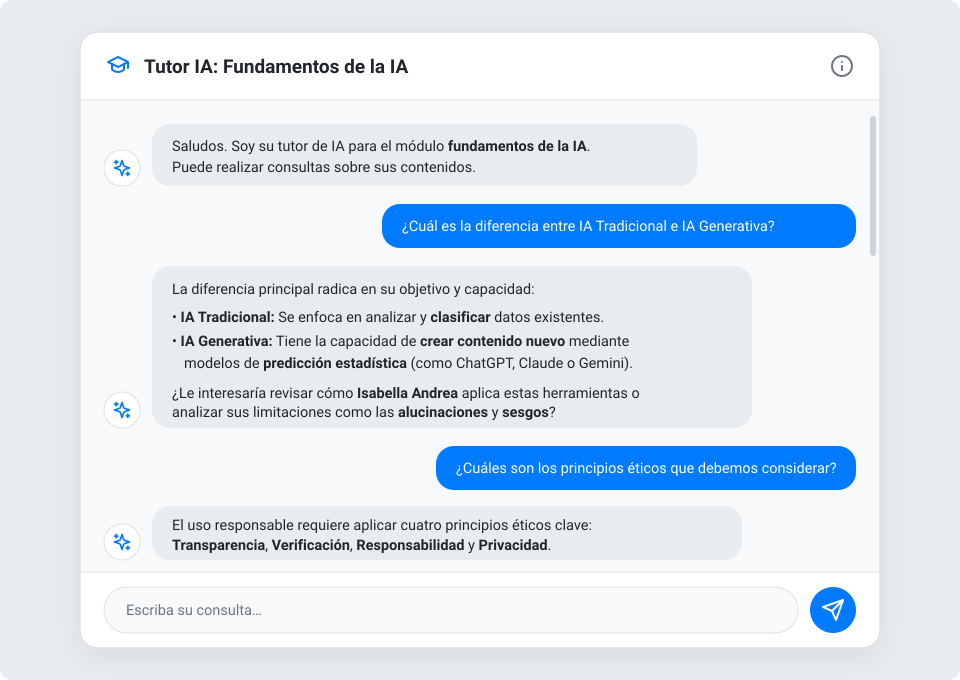

<div align="center">

# 🎓 Chatbot Tutor IA – Fundamentos de la IA

**Asistente académico conversacional impulsado por Google Gemini 2.5 Flash para el aprendizaje interactivo del módulo *"Fundamentos de la Inteligencia Artificial Generativa"*.**

[](https://ai.google.dev/)
[](https://www.typescriptlang.org/)
[](https://vitejs.dev/)

</div>

---

## 📸 Pantallazo del Chatbot

<div align="center">
  
</div>

---

## 📖 Descripción General

**Chatbot Tutor IA – Fundamentos de la IA** es una aplicación web educativa diseñada para acompañar a los estudiantes en el estudio del módulo **"Fundamentos de la IA"**. El asistente actúa como un tutor experto, formal y conciso (adaptado al español de Chile), respondiendo exclusivamente en base al material oficial del curso para evitar desviaciones temáticas y fomentar el pensamiento crítico.

---

## ✨ Funcionalidades Clave y Reglas Pedagógicas

El tutor incorpora un sistema de instrucciones estructurado en reglas de prioridad pedagógica:

- **🛡️ Regla de Ética Académica:** Rechaza de forma firme y formativa solicitudes que busquen respuestas directas a evaluaciones o pruebas, invitando al estudiante a repasar los conceptos.
- **🎯 Conocimiento Acotado al Módulo:** Responde estrictamente sobre el material docente oficial, evitando alucinaciones o respuestas fuera de contexto.
- **🔄 Refinamiento Conversacional (Follow-up):** Permite reformular explicaciones previas (ej. *"explícalo más simple"*, *"dame más detalles"* o *"hazlo más amable"*) manteniendo el hilo de la sesión.
- **⚖️ Comparaciones Estructuradas:** Genera paralelos claros entre conceptos clave, como **IA Tradicional vs. IA Generativa**.
- **💼 Aplicación Práctica (Caso de Estudio):** Conecta la teoría con el caso práctico del módulo protagonizado por **Isabella Andrea** (coordinadora de comunicaciones).
- **💡 Sugerencias Proactivas:** Al finalizar cada explicación, propone preguntas e ideas relacionadas para guiar la exploración de nuevos tópicos del módulo.
- **♿ Interfaz Adaptable y Accesible:** Diseño limpio con soporte para navegación por teclado (`Escape` para cerrar modales, regiones ARIA y enfoque automático).

---

## 📚 Contenidos del Módulo Cubiertos

1. **Fundamentos:** Definición de Inteligencia Artificial y concepto de generatividad (creación de contenido nuevo).
2. **Diferencias Clave:** IA Tradicional (clasificación y análisis) frente a IA Generativa (creación).
3. **Funcionamiento y Limitaciones:** Modelos de predicción estadística, alucinaciones, sesgos y corte de actualización del conocimiento.
4. **Herramientas Principales:** ChatGPT, Claude y Gemini.
5. **Principios Éticos:** Transparencia, Verificación, Responsabilidad y Privacidad.
6. **Adopción Organizacional:** Etapas de diagnóstico, pilotaje y optimización.
7. **Caso de Estudio:** Uso estratégico de IA por parte de *Isabella Andrea* en gestión de comunicaciones.

---

## 🛠️ Tecnologías Utilizadas

- **Motor de IA:** [Google GenAI SDK (`@google/genai`)](https://www.npmjs.com/package/@google/genai) con el modelo `gemini-2.5-flash`.
- **Frontend:** HTML5 semántico, CSS3 moderno (Variables CSS, Flexbox/Grid, animaciones suaves) y tipografía *Montserrat*.
- **Lenguaje y Empaquetado:** TypeScript (`~5.8.2`) + Vite (`^6.2.0`).

---

## 🚀 Instalación y Ejecución Local

### Prerrequisitos

- **Node.js** (versión 18 o superior recomendada)
- Una **API Key de Google Gemini** (puedes obtenerla en [Google AI Studio](https://aistudio.google.com/))

### Pasos

1. **Clonar el repositorio e instalar dependencias:**
   ```bash
   npm install
   ```

2. **Configurar las variables de entorno:**
   Crea o edita el archivo `.env.local` en la raíz del proyecto y define tu clave de API:
   ```env
   GEMINI_API_KEY=tu_clave_api_de_gemini_aqui
   ```

3. **Iniciar el servidor de desarrollo:**
   ```bash
   npm run dev
   ```
   La aplicación estará disponible en `http://localhost:3000`.

4. **Compilar para producción (opcional):**
   ```bash
   npm run build
   npm run preview
   ```

---

## 📂 Estructura del Proyecto

```text
├── public/
│   └── screenshot-chatbot.svg   # Pantallazo ilustrativo de la interfaz del chatbot
├── index.html                   # Estructura principal y modal de créditos
├── index.css                    # Estilos globales, burbujas de chat y diseño responsivo
├── index.tsx                    # Lógica del Chatbot, integración con Gemini 2.5 Flash y reglas del tutor
├── vite.config.ts               # Configuración de Vite y variables de entorno
├── tsconfig.json                # Configuración de TypeScript
├── metadata.json                # Metadatos de la aplicación
└── package.json                 # Dependencias y scripts de ejecución
```

---

## 👏 Créditos y Reconocimientos

- **Diseño y contenido académico:** Francisco Sereño
- **Desarrollo y tecnología:** Creado con la asistencia de Google AI sobre el modelo **Gemini 2.5 Flash**.
- **Versión:** v2.4
